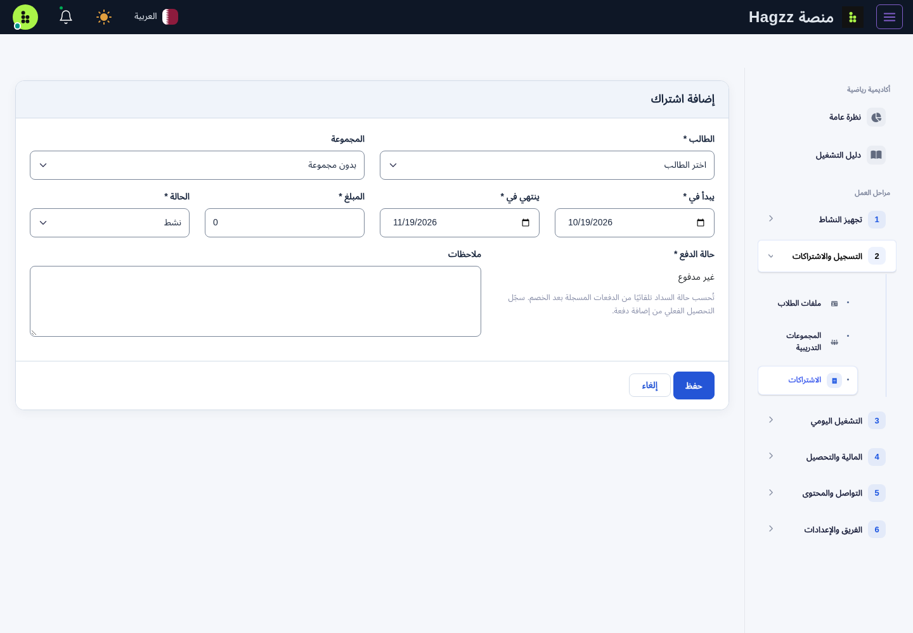
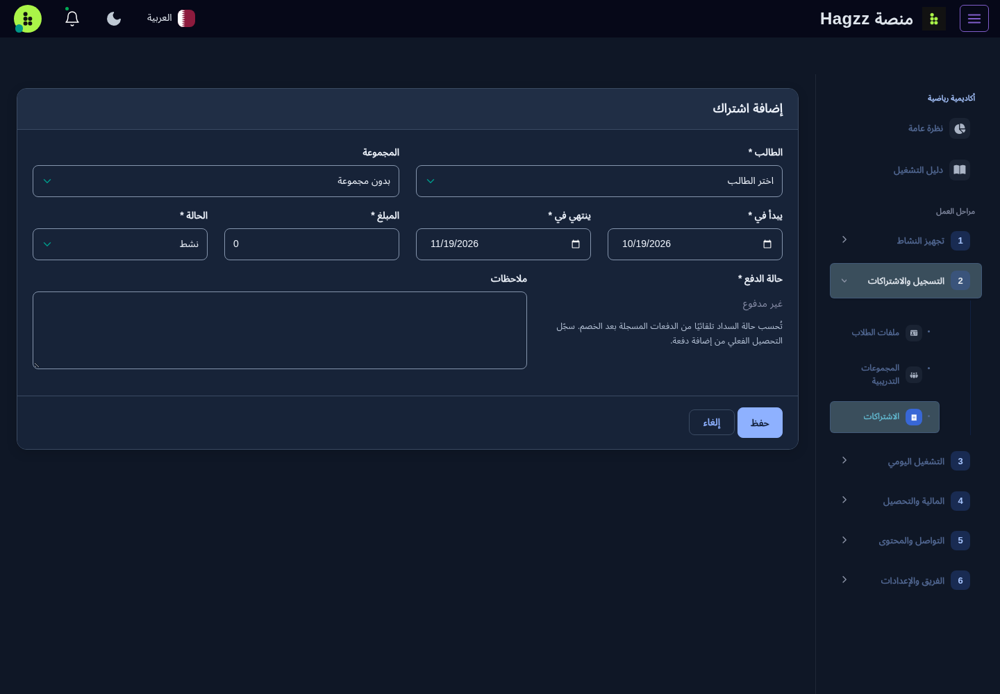
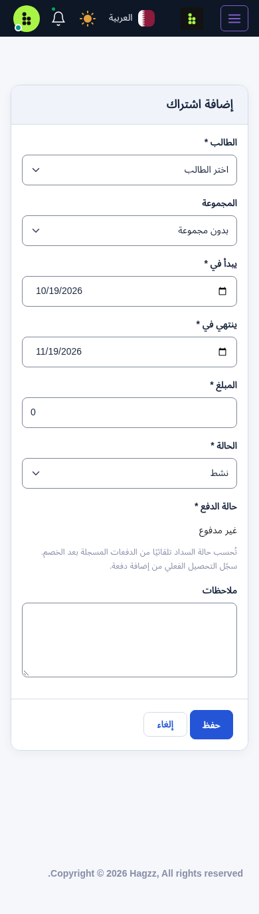

# توحيد واجهة لوحة الشركاء

حدود الحقول أصبحت رمادية واضحة بدل الحواف شبه البيضاء، مع إطار تركيز أزرق وحالة خطأ حمراء. الحقول ذات الأيقونات لها إطار واحد حول المجموعة؛ القوائم المتعددة وحقول الملفات تحافظ على وظائفها.

تستخدم النماذج والبطاقات والعناوين وأزرار الحفظ والرجوع ألوانًا ومسافات وزوايا موحدة، تشمل المواقع والمدربين والبرامج واللاعبين والمجموعات والاشتراكات والحضور والمصروفات والتقارير والفريق. تبقى ألوان الحضور والتحذير والحذف والتحصيل المالية ذات دلالتها. يدعم التنسيق العربية والإنجليزية والوضعين الفاتح والداكن والهاتف.

ملف التنسيق المشترك `public/assetsAdmin/src/assets/css/partner-ui.css` يُحمّل بعد تنسيقات الصفحات، ويقتصر على صفحات لوحة الشركاء. يتغير رابط الملف عند تعديله لمنع استمرار نسخة قديمة من الكاش. لا تتغير وظائف النماذج أو البيانات أو تنسيق فواتير الطباعة المستقلة.

## المعاينة المحلية

هذه اللقطات ببيانات تجريبية، ولا تثبت تطبيق التعديل على سيرفر الإنتاج.

### الوضع الفاتح

### الوضع الداكن

### الهاتف

## التحقق

- مراجعة متصفح لـ٤٤ حالة: ١١ صفحة × لغتين × وضعين، مع تباين حدود الحقول لا يقل عن ٣:١ دون إطارات مزدوجة.
- فحص التركيز وحالة الخطأ، وعدم وجود تجاوز أفقي للمحتوى في ست صفحات هاتف.
- مراجعة عشر صفحات قوائم، وفتح قائمة Select2 ونافذة إضافة المصروف، دون أخطاء JavaScript.
- تباين نص زر الحفظ لا يقل عن ٤٫٥:١ في الوضعين الفاتح والداكن.
- نجاح اختبارات PHP القائمة: ٣٥ اختبارًا و٣٨٤ تحققًا.

لتطبيق التغيير على السيرفر، يلزم جلب أحدث `master` وإعادة بناء وتشغيل خدمة `academy` وتنظيف قوالب Blade. لا توجد ترحيلات قاعدة بيانات جديدة لهذا التعديل.
